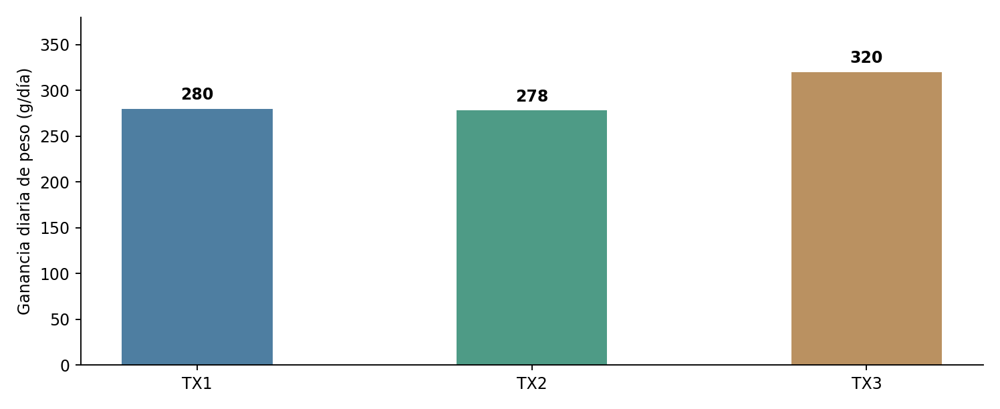
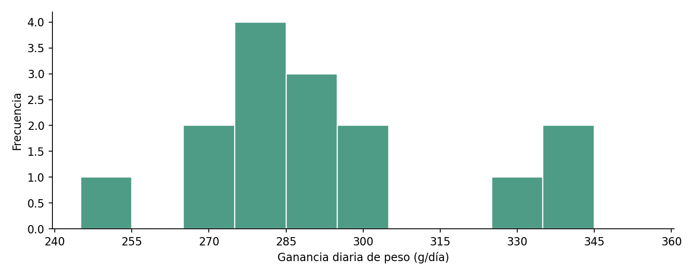
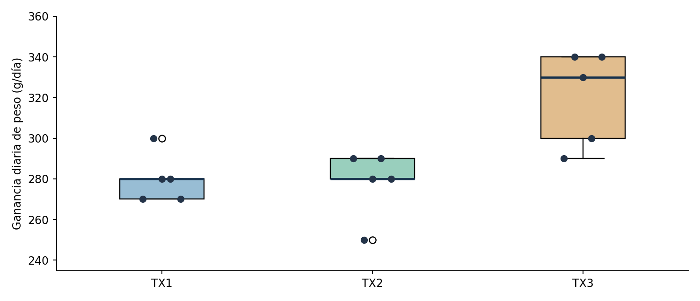
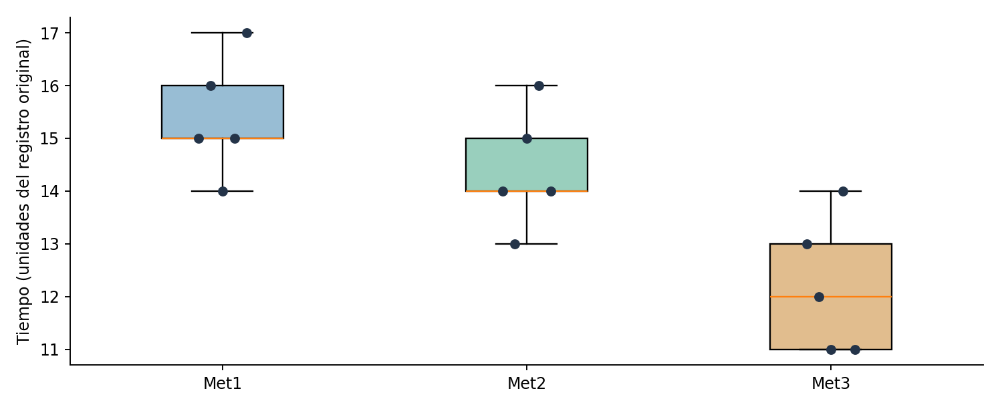

::: {.callout-note}
**Duración sugerida: 8 horas.** Estadística descriptiva, variabilidad biológica y visualización.
:::

En el capítulo anterior organizamos las observaciones de 15 becerros distribuidos en tres tratamientos. Ahora queremos responder algunas preguntas: ¿cuál es su ganancia de peso promedio?, ¿todos los animales responden igual?, ¿qué tan variables son los resultados?, ¿qué información aporta un gráfico que no encontramos fácilmente en una tabla?

La **estadística descriptiva** reúne procedimientos para organizar, resumir y representar las observaciones mediante tablas, medidas numéricas y gráficos. Permite explorar el centro, la dispersión y la forma de los datos, pero por sí sola no demuestra que una diferencia entre grupos se deba al tratamiento (Webb, 2021).

## Recuperando nuestra base de becerros

```{r}
#| label: base-becerros

#### GENERAMOS NUESTRA BASE DE DATOS ----------------
becerro <- 1:15

TX <- c(
  1, 1, 1, 1, 1,
  2, 2, 2, 2, 2,
  3, 3, 3, 3, 3
)

GAN <- c(
  270, 300, 280, 280, 270,
  290, 250, 280, 290, 280,
  290, 340, 330, 300, 340
)

DATA <- data.frame(becerro, TX = factor(TX), GAN)

#### INSPECCIÓN DE DATOS ----------------
str(DATA)
head(DATA)
summary(DATA)
colSums(is.na(DATA))
```

### Población, muestra y unidad de observación

La **población** es el conjunto de individuos u observaciones sobre el cual queremos obtener información. Una **muestra** es la parte de esa población que efectivamente estudiamos. La **unidad de observación** es el elemento sobre el cual registramos una medida (Webb, 2021).

En nuestro ejemplo, los 15 becerros constituyen el conjunto observado. Si nuestro objetivo fuera generalizar los resultados a una población más amplia de becerros, necesitaríamos definir sus características y considerar cómo fueron seleccionados los animales.

La **unidad experimental** es aquella que recibe un tratamiento asignado de manera independiente. Puede coincidir con el animal, pero si la alimentación se aplica a todo un corral, por ejemplo, podría ser el corral. Esta distinción es crucial al diseñar y analizar experimentos (Festing y Altman, 2002).

## Medidas de tendencia central

Las **medidas de tendencia central** describen dónde se ubica el centro de un conjunto de observaciones. Las más utilizadas son la media, la mediana y la moda (Webb, 2021).

### Media aritmética

La **media** es la suma de los valores dividida entre el número de observaciones. En una muestra se expresa como:

$$
\bar{x}=\frac{\sum_{i=1}^{n}x_i}{n}
$$

```{r}
#| label: media

#### CALCULAMOS LA MEDIA ----------------
mean(DATA$GAN)

#### OTRA FORMA DE CALCULARLA ----------------
sum(DATA$GAN) / length(DATA$GAN)
```

La ganancia diaria de peso promedio es **292.67 g/día**. Esta cifra resume los 15 registros, pero no significa que todos los animales hayan presentado exactamente esa ganancia.

### Mediana

La **mediana** es el valor central de los datos ordenados de menor a mayor. Es menos sensible a valores extremos que la media y puede ser útil cuando la distribución es asimétrica (Webb, 2021).

```{r}
#| label: mediana

#### MEDIANA ----------------
median(DATA$GAN)
sort(DATA$GAN)
```

La mediana es **290 g/día**.

### Moda

La **moda** es el valor que aparece con mayor frecuencia. Puede existir más de una moda si diferentes valores comparten la frecuencia máxima. Para identificarla no debemos utilizar `mode()` de R, ya que esa función describe el almacenamiento interno de un objeto.

```{r}
#| label: moda

#### FRECUENCIA DE LAS OBSERVACIONES ----------------
table(DATA$GAN)
```

### ¿Qué sucede cuando encontramos un valor extremo?

```{r}
#| label: valor-extremo-media-mediana

#### MODIFICAMOS UNA OBSERVACIÓN ----------------
DATA2 <- DATA
DATA2$GAN[15] <- 500

mean(DATA$GAN)
mean(DATA2$GAN)
median(DATA$GAN)
median(DATA2$GAN)
```

La media aumenta de 292.67 a **303.33 g/día**, mientras que la mediana permanece en 290 g/día. Esta diferencia ilustra por qué debemos conocer la distribución antes de elegir cómo resumirla.

## Variabilidad biológica

La **variabilidad biológica** se refiere a las diferencias entre individuos, incluso cuando comparten características y condiciones de manejo. En los sistemas de producción animal, esas diferencias pueden relacionarse con genética, fisiología, alimentación, ambiente, estado sanitario y otras fuentes de variación.

La variabilidad influye también en la capacidad de un experimento para detectar efectos. Una diferencia promedio entre tratamientos puede ser relativamente clara cuando la dispersión individual es pequeña, y más difícil de distinguir cuando las respuestas son heterogéneas. La interpretación de resultados requiere considerar tanto la magnitud del efecto como la variación y el diseño del estudio (Festing y Altman, 2002).

### Rango

El **rango** es la diferencia entre el máximo y el mínimo observado. Resume la amplitud total de los datos, aunque solo utiliza dos valores y por ello es sensible a observaciones extremas.

$$
R=x_{\max}-x_{\min}
$$

```{r}
#| label: rango

#### RANGO ----------------
min(DATA$GAN)
max(DATA$GAN)
max(DATA$GAN) - min(DATA$GAN)
```

Los valores van de 250 a 340 g/día: el rango es **90 g/día**.

### Varianza

La **varianza muestral** cuantifica la dispersión alrededor de la media mediante la suma de las desviaciones elevadas al cuadrado, dividida entre los grados de libertad de la muestra (Webb, 2021).

$$
s^2=\frac{\sum_{i=1}^{n}(x_i-\bar{x})^2}{n-1}
$$

```{r}
#| label: varianza

#### VARIANZA ----------------
var(DATA$GAN)

#### DE DÓNDE SALE EL CÁLCULO ----------------
MEDIA <- mean(DATA$GAN)
DESVIACIONES <- DATA$GAN - MEDIA
CUADRADOS <- DESVIACIONES^2
SC <- sum(CUADRADOS)
VARIANZA <- SC / (length(DATA$GAN) - 1)
VARIANZA
```

La varianza es aproximadamente **678.10 (g/día)²**. Las unidades al cuadrado hacen que no sea tan intuitiva como la desviación estándar, pero su cálculo resulta esencial para comprender ANOVA.

### Desviación estándar

La **desviación estándar (DE)** es la raíz cuadrada de la varianza. Expresa la dispersión de los valores en las mismas unidades que la variable original (Webb, 2021).

$$
s=\sqrt{\frac{\sum_{i=1}^{n}(x_i-\bar{x})^2}{n-1}}
$$

```{r}
#| label: desviacion-estandar

#### DESVIACIÓN ESTÁNDAR ----------------
sd(DATA$GAN)
sqrt(var(DATA$GAN))
```

La DE es aproximadamente **26.04 g/día**. No describe la precisión de la media: ese es otro concepto, denominado *error estándar*, que estudiaremos más adelante.

### Coeficiente de variación

El **coeficiente de variación (CV)** relaciona la desviación estándar con la media y expresa la dispersión relativa como porcentaje. Se utiliza con variables positivas en escala de razón, cuando la media está suficientemente alejada de cero (Webb, 2021).

$$
CV=\frac{s}{\bar{x}}\times100
$$

```{r}
#| label: coeficiente-variacion

#### COEFICIENTE DE VARIACIÓN ----------------
CV <- (sd(DATA$GAN) / mean(DATA$GAN)) * 100
CV
```

El CV de los 15 animales es aproximadamente **8.90%**.

## Comparando los tratamientos

Ahora podemos calcular las medias y desviaciones estándar de los tres tratamientos. La descripción por grupos es importante: dos grupos pueden tener medias parecidas y dispersión muy distinta.

```{r}
#| label: resumen-tratamientos

#### MEDIA POR TRATAMIENTO ----------------
aggregate(GAN ~ TX, data = DATA, FUN = mean)

#### DESVIACIÓN ESTÁNDAR POR TRATAMIENTO ----------------
aggregate(GAN ~ TX, data = DATA, FUN = sd)
```

| Tratamiento | Media (g/día) | DE (g/día) | CV (%) |
|:------------|---------------:|-----------:|-------:|
| TX1         | 280.00         | 12.25      | 4.37   |
| TX2         | 278.00         | 16.43      | 5.91   |
| TX3         | 320.00         | 23.45      | 7.33   |

El tratamiento 3 presenta una media mayor y también mayor dispersión. Estas diferencias son **descriptivas**: para estudiar formalmente el efecto del tratamiento necesitaremos considerar la asignación experimental y el análisis inferencial.

{fig-alt="Media de ganancia diaria de peso por tratamiento"}

## Distribución de frecuencias e histogramas

Una **distribución de frecuencias** muestra cuántas observaciones aparecen en cada valor o intervalo. Es una primera forma de identificar dónde se concentran los registros.

```{r}
#| label: frecuencia-ganancia

#### FRECUENCIA DE GANANCIA DE PESO ----------------
table(DATA$GAN)
```

Un **histograma** representa gráficamente la distribución de una variable cuantitativa mediante intervalos consecutivos. La altura de las barras expresa la frecuencia o la densidad, según la escala utilizada. Permite examinar el centro, la dispersión, la asimetría y posibles valores alejados del conjunto (Webb, 2021).

```{r}
#| label: histograma

#### HISTOGRAMA ----------------
hist(DATA$GAN)

#### VAMOS A DARLE ALGO DE COLOR ----------------
hist(
  DATA$GAN,
  col = "aquamarine3",
  main = "Ganancia diaria de peso",
  xlab = "Ganancia diaria de peso (g/día)",
  ylab = "Frecuencia"
)
```

{fig-alt="Histograma de las ganancias de peso originales"}

También podemos agregar una curva de densidad. Para que las escalas sean compatibles, el histograma debe utilizar densidad en lugar de frecuencia absoluta.

```{r}
#| label: histograma-densidad

#### HISTOGRAMA CON CURVA DE DENSIDAD ----------------
hist(
  DATA$GAN,
  probability = TRUE,
  col = "slategray4",
  xlab = "GDP (g/día)",
  ylab = "Densidad"
)

lines(density(DATA$GAN), lwd = 2, col = "blue")
```

Con solo 15 observaciones, la forma visual de la distribución depende mucho de los intervalos y del suavizado. Por eso debemos evitar conclusiones demasiado firmes sobre normalidad u otras características de la distribución.

## Diagramas de caja y cuartiles

Los **cuartiles** dividen los datos ordenados en cuatro partes. El primero (Q1) corresponde al percentil 25 y el tercero (Q3), al percentil 75. La diferencia **RIC = Q3 − Q1** se denomina *rango intercuartílico* y contiene el 50% central de las observaciones.

Un **diagrama de caja o boxplot** muestra la mediana, los cuartiles y los bigotes. En la representación habitual de R, los bigotes terminan en los valores más extremos situados dentro de 1.5 veces el RIC desde cada cuartil; los puntos fuera de esos límites se señalan por separado (Webb, 2021).

```{r}
#| label: boxplot-base

#### GRÁFICO DE CAJA ----------------
boxplot(DATA$GAN)

#### POR TRATAMIENTO ----------------
boxplot(
  GAN ~ TX,
  data = DATA,
  col = rainbow(3),
  xlab = "Tratamiento",
  ylab = "GDP (g/día)"
)
```

{fig-alt="Diagrama de caja con observaciones individuales originales"}

Para mostrar también a cada animal podemos utilizar `ggplot2`, que permite superponer puntos individuales sobre las cajas.

```{r}
#| label: grafico-ggplot2
#| eval: false

#### GRÁFICO CON GGPLOT2 ----------------
# Instalar una sola vez:
install.packages("ggplot2")

library(ggplot2)

ggplot(DATA, aes(x = TX, y = GAN, fill = TX)) +
  geom_boxplot(alpha = 0.4) +
  geom_jitter(width = 0.08, size = 2.5) +
  labs(
    x = "Tratamiento",
    y = "Ganancia diaria de peso (g/día)"
  ) +
  theme_classic()
```

## Valores atípicos

Un **valor atípico** es una observación considerablemente diferente del resto de los datos. Puede representar una respuesta biológica real, un problema de medición, un error de captura o una condición específica del experimento. No debe eliminarse automáticamente: primero necesitamos revisar su origen y su influencia sobre los resultados (Webb, 2021; Festing y Altman, 2002).

```{r}
#| label: valores-atipicos

#### VALORES ATÍPICOS ----------------
boxplot.stats(DATA$GAN)$out

#### MODIFICAMOS UNA OBSERVACIÓN ----------------
DATA2 <- DATA
DATA2$GAN[15] <- 500

par(mfrow = c(1, 2))
boxplot(DATA$GAN, main = "Datos originales")
boxplot(DATA2$GAN, main = "Valor modificado")
par(mfrow = c(1, 1))
```

::: {.callout-tip title="Experimentemos"}
¿Cómo cambian la media, la mediana y la desviación estándar cuando sustituimos 340 por 500 g/día? ¿Qué información necesitaríamos antes de decidir si el registro es correcto?
:::

## Otros gráficos para examinar grupos

Los gráficos de `ggpubr` y `yarrr` pueden reunir observaciones y resúmenes descriptivos en una misma figura. Conviene saber qué representan los elementos del gráfico: por ejemplo, una desviación estándar no es lo mismo que un error estándar o un intervalo de confianza.

```{r}
#| label: graficos-adicionales
#| eval: false

#### MEDIAS Y DESVIACIÓN ESTÁNDAR ----------------
# Instalar una sola vez:
install.packages("ggpubr")

library(ggpubr)

ggline(
  DATA,
  x = "TX",
  y = "GAN",
  add = c("mean_sd", "jitter"),
  xlab = "Tratamiento",
  ylab = "GDP (g/día)"
)

#### PIRATE PLOT ----------------
# Instalar una sola vez:
install.packages("yarrr")

library(yarrr)

pirateplot(
  GAN ~ TX,
  data = DATA,
  theme = 2,
  xlab = "Tratamiento",
  ylab = "GDP (g/día)"
)
```

## Práctica complementaria: corredores

Los procedimientos descriptivos se pueden aplicar a distintas variables. Vamos a construir una segunda base con tiempos de 15 corredores distribuidos en tres métodos. Este ejemplo nos ayudará a comprobar que describir los datos no depende de la especie o del tipo de respuesta, sino de la variable y de nuestra pregunta de investigación.

```{r}
#| label: base-corredores

#### BASE DE CORREDORES ----------------
CORREDOR <- 1:15
MET <- factor(rep(c("Met1", "Met2", "Met3"), each = 5))

Tiempo <- c(
  15, 16, 14, 15, 17,
  14, 13, 15, 16, 14,
  13, 12, 11, 14, 11
)

DATAm <- data.frame(CORREDOR, MET, Tiempo)
str(DATAm)

#### EXPORTAR E IMPORTAR DATOS ----------------
write.csv(DATAm, "CORREDORES.csv", row.names = FALSE)

DATAm2 <- read.csv("CORREDORES.csv")
DATAm2$MET <- as.factor(DATAm2$MET)

#### DESCRIPCIÓN ----------------
aggregate(Tiempo ~ MET, data = DATAm2, FUN = mean)
aggregate(Tiempo ~ MET, data = DATAm2, FUN = sd)
boxplot(Tiempo ~ MET, data = DATAm2, col = rainbow(3))
```

| Método | n | Tiempo promedio | Desviación estándar |
|:-------|--:|----------------:|--------------------:|
| Met1   | 5 | 15.4            | 1.14                |
| Met2   | 5 | 14.4            | 1.14                |
| Met3   | 5 | 12.2            | 1.30                |

{fig-alt="Distribución de tiempos por método"}

Si el recorrido fue equivalente para todos, el método 3 presenta descriptivamente el menor tiempo medio. Sin embargo, no podemos atribuir esa diferencia al entrenamiento sin conocer el diseño del experimento y aplicar procedimientos inferenciales adecuados.

## Actividad integradora

Utilizando la base de **15 becerros**, identifica la variable de respuesta y el factor de tratamiento. Calcula media, mediana, varianza, desviación estándar y CV del conjunto completo y de cada tratamiento. Construye un histograma y un diagrama de caja con observaciones individuales. Después redacta un párrafo que describa los resultados sin afirmar todavía que existe un efecto del tratamiento.

::: {.callout-example title="Ejemplo de interpretación"}
Se analizaron los registros de ganancia diaria de peso de 15 becerros distribuidos en tres tratamientos. La media general fue de 292.67 g/día, con DE de 26.04 g/día y CV de 8.90%. Las medias de TX1, TX2 y TX3 fueron de 280, 278 y 320 g/día. El tercer tratamiento presentó la mayor media y la mayor dispersión. Estas diferencias describen los datos observados y deberán evaluarse posteriormente con un análisis que considere el diseño experimental.
:::

## Lo que aprendimos

La media y la mediana permiten describir la posición central de los datos. La varianza, desviación estándar y CV ayudan a caracterizar su dispersión. Los histogramas, boxplots y gráficos con observaciones individuales permiten identificar patrones y posibles valores extremos. Estos procedimientos son indispensables antes de realizar un análisis inferencial.

En la siguiente sección estudiaremos distribuciones, muestreo, teorema central del límite, error estándar e intervalos de confianza.

::: {.grid}
::: {.g-col-6}
[← Anterior](capitulo-01.qmd){.btn .btn-outline-primary}
:::
::: {.g-col-6 style="text-align: right;"}
[Siguiente →](recursos.qmd){.btn .btn-primary}
:::
:::

---

Dr. Juan Carlos Ángeles Hernández  
Departamento de Medicina y Zootecnia de Rumiantes  
FMVZ–UNAM · Sección I
