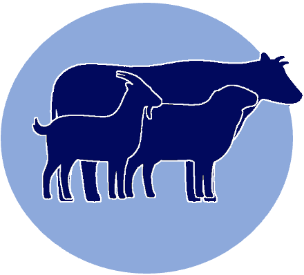

::: {.content-visible when-format="html"}
::: {.institutional-logos aria-label="Identidad institucional"}
{fig-alt="Escudo de la UNAM"}
{fig-alt="Escudo de la Facultad de Medicina Veterinaria y Zootecnia"}
{fig-alt="Emblema de rumiantes"}
:::
:::

::: {.hero}
::: {.kicker}
Un curso para comprender la investigación animal
:::

# Ciencia Animal a través de los Datos {.unnumbered}

Exploración, análisis y razonamiento estadístico con R.

::: {.hero-topics}
Comprender · Simular · Analizar · Interpretar
:::

::: {.byline}
**Dr. Juan Carlos Ángeles Hernández**  
Profesor-Investigador  
Departamento de Medicina y Zootecnia de Rumiantes  
Facultad de Medicina Veterinaria y Zootecnia  
Universidad Nacional Autónoma de México
:::
:::

## Primer encuentro con los datos {.unnumbered}

En esta primera sección aprenderemos a construir bases de datos, reconocer variables y describir su variabilidad. Utilizaremos ejemplos de becerros y corredores, con prácticas guiadas en R, gráficos y actividades de interpretación. El contenido se organiza en dos capítulos que suman 14 horas de trabajo.

::: {.grid}
::: {.g-col-12 .g-col-md-6}
::: {.callout-note title="CAPÍTULO 1 · 6 HORAS"}
### Nuestros primeros pasos en R {.unnumbered}

Objetos, vectores, matrices, funciones, variables y construcción de una base con 15 becerros.

[Leer capítulo →](capitulo-01.qmd){.btn .btn-primary}
:::
:::

::: {.g-col-12 .g-col-md-6}
::: {.callout-note title="CAPÍTULO 2 · 8 HORAS"}
### ¿Qué nos dicen nuestros datos? {.unnumbered}

Media, mediana, variabilidad, gráficos, valores atípicos y descripción de tratamientos.

[Leer capítulo →](capitulo-02.qmd){.btn .btn-primary}
:::
:::
:::

::: {.callout-tip title="Cómo utilizar el material"}
Lee las definiciones, copia cada bloque de R, ejecútalo en RStudio y compara tus resultados con los ejemplos. Los scripts y bases de datos están disponibles en la sección de recursos.
:::

[Comenzar la Sección I](capitulo-01.qmd){.btn .btn-primary .btn-lg}

---

::: {.footer-note}
Dr. Juan Carlos Ángeles Hernández · Departamento de Medicina y Zootecnia de Rumiantes · FMVZ–UNAM · Sección I
:::
